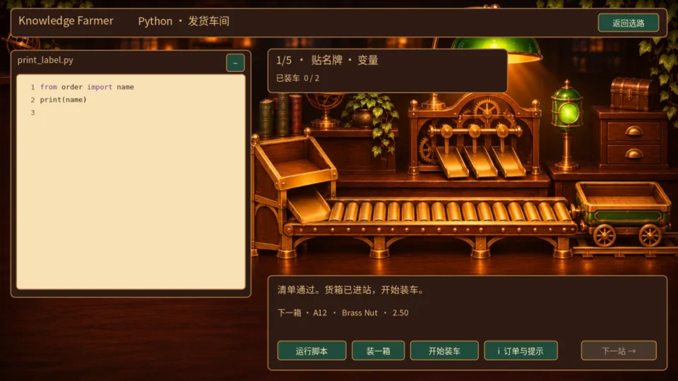
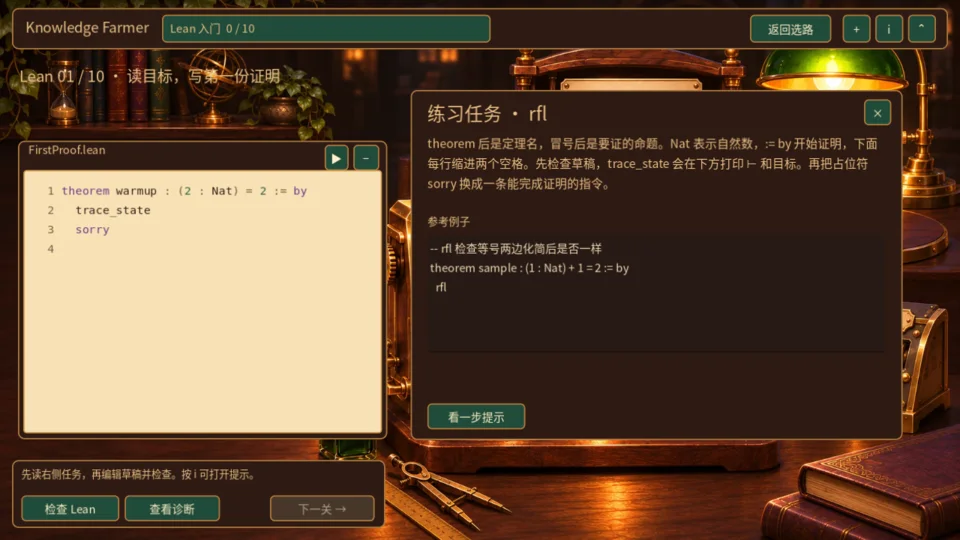

# Knowledge-Farmer


## English summary

Knowledge-Farmer is a Chinese-language learning game for Python automation and formal mathematics with Lean 4. Write scripts to process orders and web catalogs in the shipping workshop, or build and check proofs in the math workshop. Each completed challenge unlocks the next one.

## 项目用途

Knowledge-Farmer 是一款中文闯关学习游戏，用动手写代码来练习 **Python 自动化** 和 **Lean 4 数学证明**。打开游戏 **Knowledge Farmer** 后，选择 Python 或 Math。游戏会运行你写的脚本或检查你写的证明，通过后解锁下一关。每条路线独立保存草稿和进度。

- **Python · 发货车间**。从打印名牌、变量、字典和 `for` 循环起步，再用 Python 清理 CSV 报价、从练习网页提取商品数据。脚本通过两批订单的验收后，可以操作输送带装车。
- **Math · 证明工坊**。先过十个 Lean 4 入门关，练习读目标、改写、定义、递归、归纳和导入。接下来用已学工具推导奇数和等数学结论。按 `i` 看例子和分步提示，按 `⌃` 打开知识树，复习已解锁的关卡。

在证明工坊里，可以用 `+` 新建 Lean 文件，并在另一个草稿中用 `import Notebook1` 引用它。窗口标题可以拖动，按 `−` 收起后，点文件牌即可恢复。

## 游戏截图



*The first Python challenge prints a cargo label from an order. After the script passes inspection, the crates are ready to load.*



*The first Lean 4 challenge puts the editable proof on the left and a worked example on the right.*

## 支持系统

| 系统 | 运行方式 |
| --- | --- |
| Windows x64 | 下载 ZIP，内含 Python 和 Lean 4 运行时 |
| Android ARM64 | 下载 APK。安装要求为 Android 7.0（API 24）或更新版本以及 64 位 ARM 设备。关卡已在 Android 11 模拟器上验证，ARM64 真机兼容性仍待验证 |
| Linux x86_64 | 使用 Godot、Python 和 Lean 4 从源码运行 |

## 安装

从同一版本的 GitHub 发布页选择对应附件。[Releases](https://github.com/watch-if/Knowledge-Farmer/releases)

1. **Windows**。下载 `Knowledge-Farmer-Windows-x64.zip`，解压整个 ZIP，再运行 `Knowledge-Farmer.exe`。将 `python` 和 `lean` 文件夹留在 EXE 同目录。
2. **Android**。下载 ARM64 APK，在手机下载完成后打开并安装。如果系统询问是否允许从当前来源安装，按系统提示操作。文件名含 `preview` 的试装包使用独立包名和存档。

较早的发布使用 `farmer` 作为文件名前缀，Windows 解压后运行其中的 `farmer.exe`。

## 示例

### Python · 打印货物名牌

游戏提供的订单模块把当前货物的名称放在 `name` 里。这段脚本会打印该名称，例如 `Brass Nut`。更换订单后，输出会随货物变化。

```python
from order import name

print(name)
```

### Math · 完成第一份 Lean 证明

把第一关草稿里的 `sorry` 换成 `rfl`，点击「检查 Lean」。`trace_state` 会显示当前目标 `⊢ 2 = 2`，`rfl` 完成这份证明。

```lean
theorem warmup : (2 : Nat) = 2 := by
  trace_state
  rfl
```

## 从源码运行

准备 Godot 4.6.3、Python 3.9 或更新版本以及 Lean 4.19.0。将 `python3` 和 `lean` 放在 PATH 中，也可以用 `FARMER_PYTHON` 和 `ZETA_LEAN` 指定解释器位置。

```bash
git clone https://github.com/watch-if/Knowledge-Farmer.git
cd Knowledge-Farmer
godot --headless --editor --import --path . --quit
godot --path .
```

也可以在 Godot 项目管理器导入 `project.godot`，按 F5 运行项目。玩家编写的脚本在本机执行，请运行自己编写或信任的代码。

## 验证与发布

```bash
export ZETA_LEAN="${ZETA_LEAN:-$(command -v lean)}"
XDG_DATA_HOME="$(mktemp -d)" godot --headless --path . --script tests/workshop_check.gd
XDG_DATA_HOME="$(mktemp -d)" godot --headless --path . --script tests/workshop_flow.gd
XDG_DATA_HOME="$(mktemp -d)" godot --headless --path . --script tests/farmer_routes.gd
```

GitHub Actions 会在发布前验证桌面和 Android 模拟器里的关卡。Windows ZIP 和 Android APK 上传后一起公开。常规联发使用仓库配置的 Android 长期签名。在「Windows and Android prerelease」工作流手动选择试装模式时，APK 使用独立包名和临时签名。

## 许可证

本项目以 MIT 许可证发布。转载或分发时，请保留原版权声明和许可证文本。[LICENSE](LICENSE)

随包附带的字体和运行时适用各自的许可证。[字体许可证](assets/FONT-LICENSE.txt)
